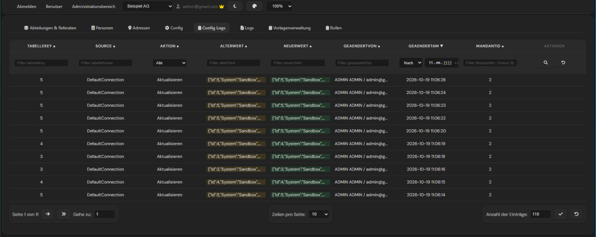
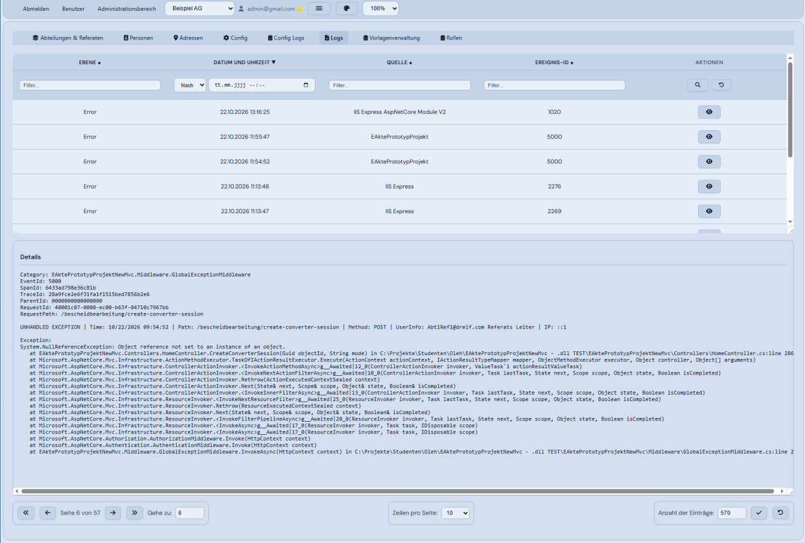

# AdminPanel

A multi-tenant administration panel built with **ASP.NET Core Razor Pages** and **SQL Server**. It lets administrators manage organisational data, configuration, templates and user roles for multiple companies from a single application, with every tenant seeing only its own data.

## Features

### Multi-tenancy (Mandant system)
- Each company (tenant) gets its own isolated view of the data.
- A **tenant provider** resolves the active tenant (Mandant) and scopes every query to it automatically.
- Tenant switcher in the top bar for administrators.
- Support for global (tenant-independent) records alongside tenant-specific ones.

### Management modules
- **Departments & Units** (Abteilungen & Referate): organisational structure
- **Persons**: people and their details
- **Addresses**: address management
- **Config**: application and connection settings editable at runtime
- **Config Logs**: full audit trail of configuration changes (old value, new value, changed by, changed at, tenant)
- **Logs**: application logs
- **Template Management** (Vorlagenverwaltung): categories, subgroups and templates
- **Roles**: role-based access control

### Data tables
- Custom **sorting** on every column
- Per-column **filtering** (text, dropdown, date range)
- **Pagination** with adjustable page size and jump-to-page
- Entry counter and one-click filter reset

### UI
- Dark and light theme
- Selectable colour themes
- Adjustable page zoom
- Responsive tabbed navigation

## Tech stack

| Layer | Technology |
|-------|------------|
| Framework | ASP.NET Core (Razor Pages) |
| Language | C# |
| Database | Microsoft SQL Server |
| Front end | HTML, CSS, JavaScript |

